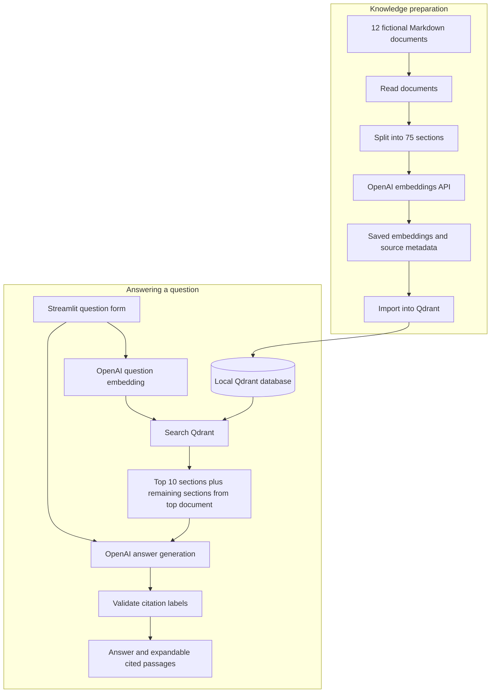

# Northstar Knowledge Assistant

A Solutions Engineer portfolio proof of concept for a fictional
SaaS support team.

## Customer problem

Support agents need reliable answers from internal guides without
manually searching multiple documents.

The assistant retrieves relevant document sections, generates an
answer, and displays citations with expandable source passages.

## Scope

- 12 fictional support documents
- 75 document sections with embeddings
- Questions about accounts, billing, onboarding, and troubleshooting
- Local browser interface
- No account changes or customer messages

All customer information and policies are fictional.

## Technology

- Python
- OpenAI text-embedding-3-small for embeddings
- OpenAI gpt-4.1-mini for answer generation
- Qdrant local mode for persistent vector storage and search
- Streamlit for the browser interface

## How it works

1. Read Markdown documents.
2. Split documents at section headings.
3. Generate and save embeddings.
4. Import vectors and source metadata into Qdrant.
5. Embed the user's question.
6. Retrieve the ten most similar sections.
7. Include remaining sections from the highest-ranked document.
8. Generate an answer using the retrieved evidence.
9. Validate citation labels and display cited passages.

## Local setup

Python 3.13.5 was used during development.

Create and activate a virtual environment:

    python3 -m venv .venv
    source .venv/bin/activate

Install dependencies:

    python -m pip install -r requirements.txt

Create a local .env file:

    OPENAI_API_KEY=your_api_key_here

Do not commit .env or share the API key.

## Build the knowledge index

On a fresh setup, run:

    python ingest.py
    python chunk.py
    python embed.py
    python index_vectors.py

The embedding step sends the fictional document sections to OpenAI
and incurs API usage charges.

The embedding and indexing scripts stop if their output already
exists. They do not currently provide an automatic rebuild workflow.

## Run the interface

    python -m streamlit run app.py --server.address 127.0.0.1

Open the local URL printed in the terminal.
Stop the app with Ctrl+C.

Each submitted question uses OpenAI for its embedding and answer.
Vector searches run locally.

## Evaluation

Run:

    python evaluate.py

The evaluation contains 20 development cases covering policy
questions, exceptions, role permissions, missing information,
and an instruction-override attempt.

The latest Qdrant evaluation completed 20/20 cases with 20/20
expected-source coverage.

Source coverage is not answer accuracy. Manual review identified
unsupported claims and incomplete answers in some runs.

These cases were used during development, so they are regression
checks rather than an independent test of generalization.

## Findings and limitations

- Retrieving only isolated sections sometimes omitted relevant
  limitations. Adding context from the highest-ranked document
  improved expected-source coverage.
- Valid citation labels do not guarantee that cited passages
  support every claim.
- Answers can omit prerequisites or add unsupported details.
- A second model review pass was tested and disabled after it
  missed omissions and introduced a factual error.
- The interface handles each question independently; it does not
  provide conversational memory.
- This is a local prototype, without authentication or a validated
  multi-user deployment.
- Document uploads and automatic index updates are not implemented.

## Next milestones

- Document the architecture and deployment plan.
- Prepare and test an AWS deployment.
- Create a customer demo script.
- Summarize measured results and limitations for the portfolio.

## Architecture

### Data flow

Documents and stored vectors remain on the local computer.
Document text is sent to OpenAI when generating embeddings.
For each question, OpenAI receives the question for embedding,
then the question and retrieved passages for answer generation.

The API key is loaded from the local environment and is not
displayed in the browser.

### Design choices

- Section headings preserve meaningful document boundaries.
- Source metadata connects answer citations to document passages.
- Additional context from the top document helps retain exceptions
  and scope limitations.
- Qdrant stores vectors and performs similarity search.
- Citation-label validation detects references to nonexistent
  evidence labels; it does not verify factual support.
- The experimental answer-review pass is disabled.